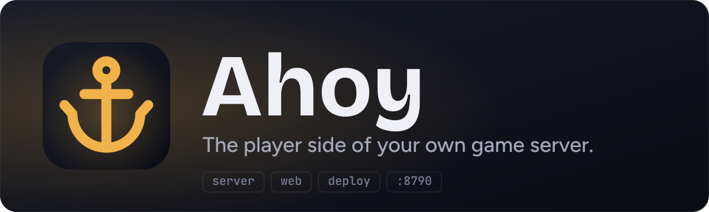
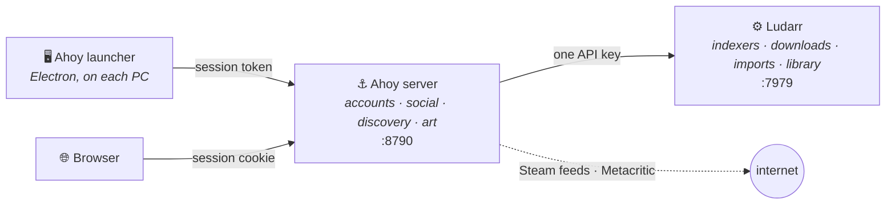

<div align="center">



<br>

**Accounts, friends, what everyone is playing, discovery, and the desktop launcher that installs and plays games.**

[](https://bun.sh)
[](https://hono.dev)
[](https://vite.dev)
[](https://bun.sh/docs/api/sqlite)
[](#-deploy)
[](server/package.json)

[Features](#-features) · [How it fits together](#-how-it-fits-together) · [Quick start](#-quick-start) · [First run](#-first-run) · [Development](#-development) · [Deploy](#-deploy)

</div>

---

Ahoy is one container with a web UI, a REST API and a self-updating Windows launcher. The finding, downloading and
preparing of games is done by **[Ludarr](https://github.com/robertson-dev/ludarr)** (the engine, formerly playarr, then arcadearr) in
its own container. Ahoy is its only client and the only thing that holds its API key.

## ✨ Features

| | |
|---|---|
| 👥 **Accounts & roles** | The first person in becomes the admin. Everyone else joins by invite code, or the admin opens or closes the door. Sessions are bearer tokens plus an httpOnly cookie. |
| 🧭 **Discovery** | Coming soon, new & trending, top sellers and *just became playable* rows from Steam's storefront feeds, genre rows (*loved by players* / *selling now*), Metacritic's highest-rated lists matched to the store, and *more like this* on every game. Every row opens into a full list, 50 at a time. |
| 🫂 **Social** | Friends, a *lately* activity feed, who is online and what they are playing right now. Everything a launcher installs or plays is attributed to the person who did it. |
| 📦 **Installs that just work** | One click requests a game from the engine; when it is ready the launcher pulls the package through Ahoy, verifies every file and plays. The engine's key never reaches a PC. |
| 🖥️ **Your PCs** | Every PC your launcher runs on is known by name. Install a game on any of them from anywhere (a phone, the couch): the order waits on the server and that PC carries it out when it is on. A game you ask for installs by itself when it arrives, on the PCs you say (Settings → Your PCs). |
| 💾 **Saves in step** | After playing, a game's saves go to the server; before playing, the newest version comes down. The last ten versions of each game stay to go back to, and when two PCs each have saves the other has not, the player chooses. Where a game keeps its saves comes from the [Ludusavi manifest](https://github.com/mtkennerly/ludusavi-manifest) (MIT; its data is [PCGamingWiki](https://www.pcgamingwiki.com)'s, CC BY-NC-SA 3.0), read every few days. |
| 🆕 **What's new** | After an update Ahoy says what changed, once per device, and keeps the list under the account menu (`web/src/whatsnew.ts`: add a note with each change players would notice). |
| 🔄 **Self-updating launcher** | The server publishes the launcher build it ships with; connected launchers pick up a newer one in the background and install it on the next restart. |
| 🛡️ **Safe on the open internet** | Sign-in and sign-up are rate-limited per address, and the server reads `X-Forwarded-For` / `X-Forwarded-Proto`, so it can sit behind a public reverse proxy. |
| 🖼️ **Art cache** | Store art is proxied and cached on the server, so pages stay fast and nothing leaks a visitor's address to a storefront. |

## 🧩 How it fits together



- **Browsers and launchers** only ever talk to Ahoy, with a per-user session.
- **Ahoy** talks to the engine with the one key the admin entered at first run, and streams package files through, so nothing engine-side is exposed to members.
- **Nothing is tied to a particular server.** The launcher asks for a server address on first run; the admin enters the engine on the server; `LUDARR_URL` / `LUDARR_API_KEY` in the container's environment only pin what the admin would otherwise type.

## 📁 Repository layout

```
server/      Bun + Hono + sqlite — accounts, sessions, friends, activity, presence, installs; discovery
             (Steam feeds, catalog cache, Metacritic lists, "more like this"); the art cache; the engine
             client; the launcher build it publishes
web/         the Ahoy UI (React + Vite), built into server/public and served at /
deploy/      unraid.py — build the image on the box and (re)create the `ahoy` container
unraid/      the Docker template
Dockerfile   web build + server in one image
sketches/    static design explorations for the UI
```

The desktop app lives in its own repo: **[ahoy-launcher](https://github.com/robertson-dev/ahoy-launcher)**.

## 🚀 Quick start

```sh
docker build -t ahoy .
docker run -d --name ahoy -p 8790:8790 -v ./config:/config ahoy
```

Open `http://<host>:8790`. A browser that is not signed in sees the front page: what Ahoy is, the launcher download,
the server address to enter and the steps.

## 🔑 First run

1. **Setup code.** The server prints a six-character code at boot (also written to `<config>/setup-code.txt`).
2. **The admin.** The first person to sign up enters that code and becomes the admin.
3. **Connect the engine.** As the last step the admin enters the engine's address and API key. Both stay on the
   server: members only see whether the engine is up, and until it is they wait outside.
4. **Invite people.** *Settings → Who can join*: hand out invite codes, or open or close the door entirely.

## 🛠️ Development

```sh
# server (:8790)
cd server && bun install
bun run dev
bun test               # 47 tests, in-memory DB
bun run typecheck

# web UI (:8791, proxies /api to the server)
cd web && bun install
bun run dev
bun run build          # → server/public
bun run typecheck
```

<details>
<summary><b>Discovery refresh intervals</b></summary>

| What | Refreshes | Knob |
|---|---|---|
| Storefront feed rows | every 60 min | `DISCOVER_REFRESH_MIN` |
| Metacritic lists | every 24 h (matches kept, misses retried weekly) | `METACRITIC_REFRESH_HOURS` |
| Catalog cache | 24 h | — |
| Browser-side cache | 10 min | — |

</details>

## 🚢 Deploy

`deploy/unraid.py` packs `server/`, `web/` and the Dockerfile, builds the image **on the box**, installs the
template under *Docker → ahoy* and (re)creates the container on `:8790`, then waits for `/api/health`.

```sh
UNRAID_HOST=<box> UNRAID_USER=root UNRAID_PASS=… python deploy/unraid.py
```

The same deploy publishes the launcher build under `<config>/launcher/` (installer, `latest.yml`, blockmap), which
is what every connected launcher checks for updates.

## 🎨 Brand

`brand/icon.svg` is the mark (also the web favicon) and `brand/banner.svg` the header above, both plain SVG with the
type outlined, so they render anywhere. Palette: navy `#0b0d14` with the lamp amber `#f2b24a`;
type: Bricolage Grotesque for the wordmark, Figtree for text, JetBrains Mono for the chips.

<p> &nbsp;  &nbsp; </p>

---

<div align="center"><sub>Ahoy · Ludarr · ahoy-launcher — three repos, one game server.</sub></div>
